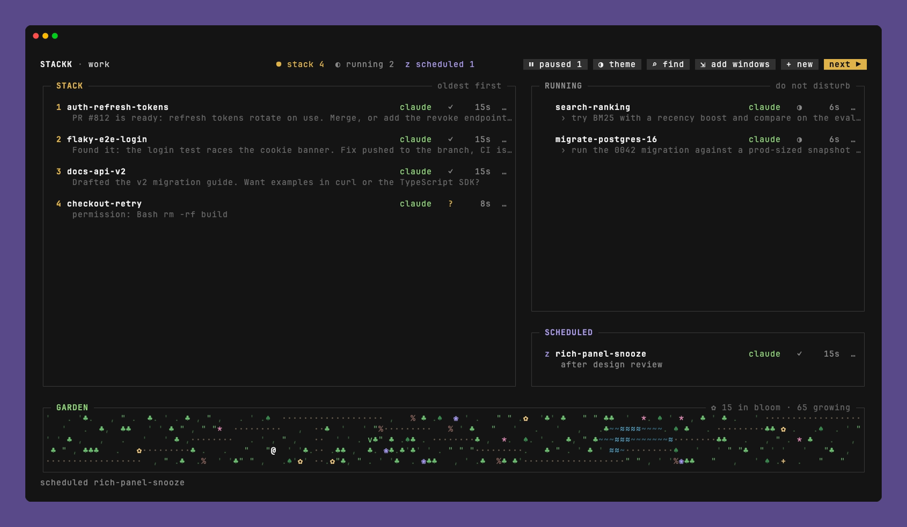
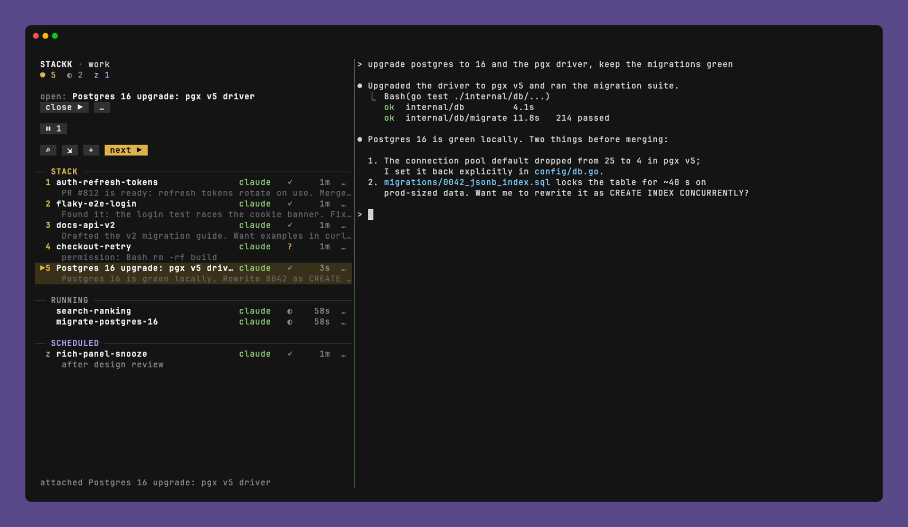
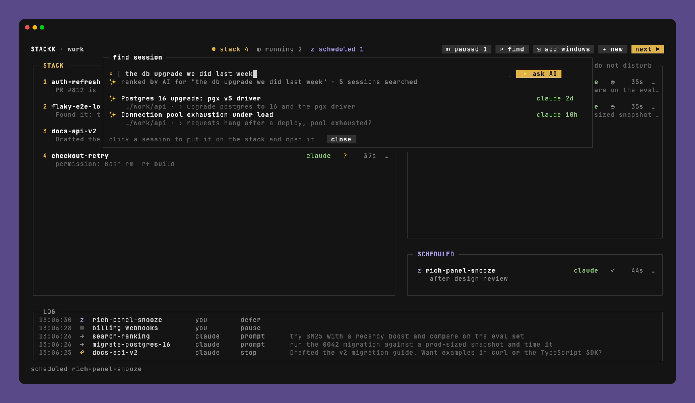
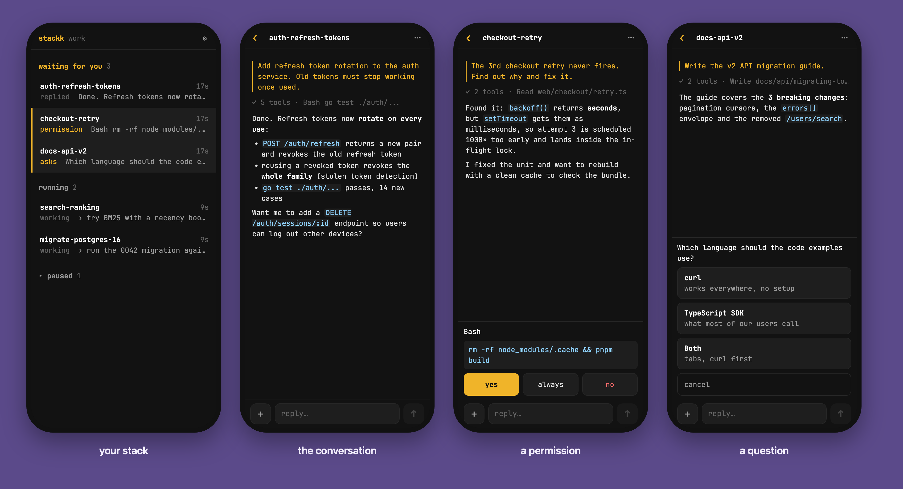

# stackk

**A round-robin stack for the AI coding sessions you juggle in tmux.**

You run a handful of Claude Code / [omp](https://github.com/can1357/oh-my-pi) sessions at once and hop between them. stackk puts them in one mouse-driven dashboard. Whoever has waited for you the longest is on top. Click it, answer, click the next one. When an agent finishes its turn, the session comes back on the stack by itself.



- **STACK**: sessions waiting for you (finished a turn, need a permission or an answer), oldest first
- **RUNNING**: agents at work, including subagents in the background, so you don't have to look
- **SCHEDULED**: work you parked on purpose; **paused** and **hidden** sessions stay out of sight until you want them

Click a session and its real terminal slides in on the right. Scrolling, selection and paste work as usual. Click the dashboard to put it away.



Closed a session weeks ago and need it back? **⌕ find** searches your past Claude and omp sessions by title, prompts and folder. Press Enter and a small model picks the matches, even when you remember it in other words. One click resumes the conversation onto the stack.



A macOS notification tells you when a session has been waiting a couple of minutes and you weren't looking. Clicking it brings the dashboard back with that session open.

## Requirements

- macOS for notifications ([terminal-notifier](https://github.com/julienXX/terminal-notifier) makes them clickable; without it they fall back to `osascript`). The rest works anywhere tmux does
- tmux 3.3+ with `set -g mouse on` (stackk is driven with the mouse)
- Go 1.24+ to build (newer toolchains download themselves via `GOTOOLCHAIN`)
- Claude Code and/or omp

## Install

```sh
git clone git@github.com:Krol22/stackk.git && cd stackk
make setup   # builds cli/ into ~/.local/bin/stackk and runs `stackk setup`
```

`stackk setup` adds stackk's hooks to `~/.claude/settings.json` (it keeps a backup and leaves your other hooks alone) and writes the omp extension to `~/.omp/agent/extensions/stackk.ts`. Sessions that were already running before this don't report anything until you restart them: `/exit`, then `claude -c` / `omp -c`.

## Use

```sh
stackk          # dashboard in the current pane; tasks live in a hidden tmux session "stackk"
stackk main     # or: turn an existing session (all its windows) into the stack
```

- **Left click** a session to open it in the drawer. Clicking the dashboard closes it, clicking another session switches to it, and dragging the border resizes it.
- **Right click** (or `…`) for Schedule, Pause, Hide, Skip, Rename, Note, Stop, Close & remove.
- **next ▶** opens the session at the head of the stack.
- **+ new** starts a session in a folder, optionally with a first prompt.
- **⌕ find** puts a past session back on the stack.
- **⇲ add windows** moves agent windows from your other sessions into the stack.

Window names carry the state, both ways: stackk appends ` st` (scheduled) and ` p` (paused), and renaming a window yourself does the same.

| state | where | meaning |
|---|---|---|
| on the stack | STACK | waiting for you, or nothing stackk can tell (`$` shell, `⁇` silent) |
| running | RUNNING | the agent is working, including subagents in the background |
| scheduled | SCHEDULED | parked by you, visible |
| paused | `⏸` modal | hidden until you bring it back; the agent keeps running |
| hidden | `⏸` modal | not a task at all (notes, an editor) |

### Themes

Click **◑ theme** to pick one, or run `stackk theme` to list them and `stackk theme <name>` to switch. Themes change the look too, not only the colors:

- **agent-tree:** dashed frames in each section's color, titles centered, `[ bracket ]` buttons
- **neon:** synthwave pink and cyan, double frames, `┤ notched ├` titles
- **charm:** rounded frames, pill titles
- **phosphor:** a green CRT, heavy frames
- **win95:** grey dialogs, navy title bars, bevelled block frames
- **minimal:** no frames at all
- palettes: stackk (the default, on your terminal's background), catppuccin-mocha, catppuccin-latte, dracula, gruvbox, nord, rose-pine, solarized-light, tokyo-night

Running dashboards follow within a few seconds. The choice is saved in `~/.config/stackk/config.json`.

### On your phone

`stackk-web` puts your stack on your phone, over Tailscale: what waits for you, the conversation, buttons for permissions and questions, replies and attachments. See [web/README.md](web/README.md).



CLI: `stackk ls [-json]`, `stackk show|send|key <task>`, `stackk log [task]`, `stackk new <folder> [prompt]`, `stackk take`, `stackk find [-ai] <query>`, `stackk attach <session>`, `stackk pause|resume|hide|unhide|rm|rename <task>`, `stackk focus [task]`, `stackk theme [<name>]`, `stackk test-notify`.

## How it works

- **Agent hooks report state:** `stackk mark claude|omp` runs on Claude's hook events and from the omp extension. Hooks are synchronous and take about 10 ms; outside a stack they exit after one tmux query.
- **tmux holds the processes:** a stack is a tmux session marked `@stackk`, and each window is a task.
- **SQLite holds the state and log:** `~/.local/state/stackk/stackk.db`.
- **The drawer swaps panes:** it `swap-pane`s the agent's real pane next to the dashboard, so scrolling, selection and paste are plain tmux.
- **Reconcile runs every few seconds.** It picks up moved and new windows, notices dead panes, and flags a silent "working" session as `⁇`.

### Security

- **Outside text never reaches the terminal as control sequences.** That means agent replies, session titles, transcripts and window names. An agent that read a hostile repo can't retitle the dashboard, write your clipboard (OSC 52) or fake what you see. Control characters and bidi overrides are stripped when text is stored and again when it's drawn.
- **stackk's state directory (`~/.local/state/stackk`) is `0700`.** It holds excerpts of your prompts, so it gets the same protection as Claude's own transcripts.
- **The AI search runs `claude -p` with no tools, no MCP servers, no saved session and none of your hooks**, in a private empty directory. It only ranks results; its reply is parsed as a list of numbers.
- **Agents are started with their arguments in environment variables**, never spliced into a shell command. A prompt full of quotes, `$`, backticks or `\` reaches the agent unchanged in fish, bash and zsh.

`DESIGN.md` has the full design, in Polish.

## Tests

```sh
make test   # unit tests
make e2e          # end-to-end on an isolated tmux server (-L stackk-test) with a fake agent:
                  # UI, stack lifecycle under fish, find, security
make perf         # performance budget: tmux calls per minute, hook latency
make demo         # record the e2e run with vhs
make screenshots  # regenerate docs/*.png (vhs, its own tmux server)
```
